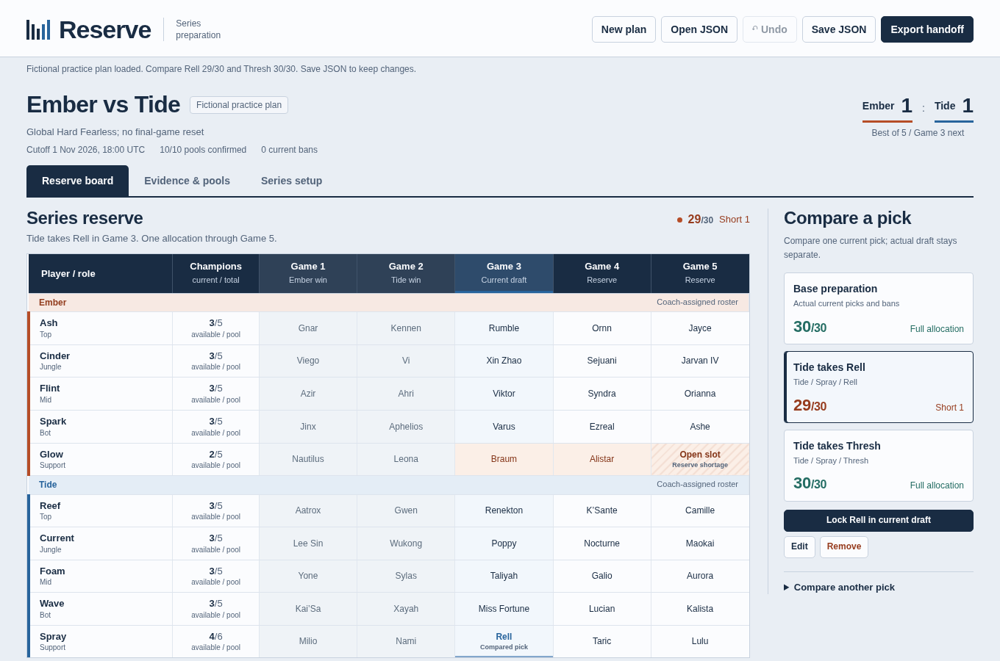

# Reserve

**Plan the whole series.** A free, local preparation workspace for competitive League of Legends coaches and analysts using global Hard Fearless.

A pool can look deep enough for each player while both teams share too few champions to fill the remaining games. Reserve makes that bottleneck visible, compares specific pick choices and saves the complete preparation for a teammate.

[Open the workspace](https://blucca.github.io/series-reserve/) · [Watch the preparation + reply demo (2:36)](https://blucca.github.io/series-reserve/demo.html) · [Method](docs/method.md) · [Email Blucca](mailto:belgialucca@gmail.com) · [Telegram](https://t.me/blucca_ai)

[38-second reserve drill](https://youtube.com/shorts/tAvfhJtbaDI) · [Recorded example and media](docs/short-drill.md)



## Prepare a series

1. Open the fictional practice plan, or choose **New plan** and name your teams and players.
2. Paste playable champion pools, or import your permitted evidence CSV. Set the evidence cutoff and optional patch filter, then review the observed counts.
3. Assign roles, edit the proposed pools and confirm them. Confirm the league rule and whether the final draft resets the champion reserve.
4. Record completed games and their winners, then the current draft’s bans and locked picks.
5. Compare a current pick. The board shows one allocation through the longest possible remaining series; a shortage shows the precise player/game slots sharing too few champion reserves.
6. **Save JSON** keeps the entire plan and imported evidence. **Export handoff** downloads a readable preparation with the rule, pools, series state, comparisons, witnesses and coach notes. Open the saved JSON to resume on **Base preparation**, with the recorded current draft. Saved comparisons remain available separately. Undo restores recent edits.

The example compares Tide’s support choices before Game 3: **Rell fills 29/30 remaining slots; Thresh fills 30/30**. All teams, players, matches and evidence in the public example are fictional.

[Protect a reserve before the opponent replies](docs/first-reply.md): a worked drill where two first picks both fill 30/30, yet the opponent’s next two picks leave different reserves. Use the existing lock, compare and Undo controls; an optional runnable study checks every available first reply and complete two-pick turn.

Keeping Alistar first? [Compare two stage-ready pool additions](docs/first-reply.md#which-extra-repairs-this-immediate-turn) in that same turn: Thresh restores every declared state; Poppy leaves one damaging reply pair. Both additions are assumptions for the fictional exercise.

Files and calculations stay in your browser. There is no account, upload endpoint, analytics or backend. Save your preparation before leaving the page.

## Try a private preparation case

For an **own-side reserve snapshot**, start with your five players’ approved pools, stable bindings, the league rule, completed games/score, current bans and picks, and two planned choices with an explicit one- or two-pick opponent reply. Known opponent picks consume the shared reserve; this scope relaxes their unforced future slots. A joint/shared-capacity check uses both lineups and their pools.

Already have a future player/champion commitment in your preparation? Include it and its required/preferred status. The standalone case can check [keeping that route](docs/method.md#check-an-existing-future-plan) separately from total reserve capacity.

[Email](mailto:belgialucca@gmail.com) or [Telegram](https://t.me/blucca_ai) to request a small private validation case to run locally. Consistent anonymized champion IDs are welcome. **The browser workspace uses ten-player joint plans; the own-side case uses the standalone matching core.**

## Evidence CSV

Required columns: `game_id,played_at,team,player,champion`. Optional: `patch,source`.

[Download the fictional CSV](demo-evidence.csv). Use ISO timestamps with timezones. `played_at` is the source timestamp used for the cutoff; observations must be strictly earlier than the cutoff. Game-start pick observations work when those picks were available to your preparation. Match a stable player ID across team changes, or use the roster’s team and player display names. The workspace reports unmatched records.

Counts are distinct player/game picks. Duplicate rows count once; contradictory picks for a player/game need correction. Spacing, case and straight/curly apostrophe variants share a champion identity. Use a consistent source name for semantic aliases such as Wukong / MonkeyKing.

Importing observations changes evidence; **Propose from observations** changes a pool and marks it for coach review. Confirmed pools stay unchanged when a time or patch filter changes. Local CSV import supports up to 20,000 observations.

## Run and check locally

No build step or application dependencies:

```sh
python3 -m http.server 8000
# Open http://localhost:8000/
python3 -B check.py
node check.mjs
```

Python 3.10+; the browser uses native ES modules. The independent checks cover exact matching, the complete fictional preparation task, bans, cutoff, coach confirmation, series completion, spelling variants and saved handoff.

The Python research core remains usable separately:

```python
from reserve import allocate

slots = {
    "our-bottom/game3": {"a", "b"},
    "our-bottom/game4": {"a", "b"},
    "their-bottom/game3": {"a", "c", "d"},
    "their-bottom/game4": {"a", "c", "d"},
}
print(allocate(slots, forced={"their-bottom/game3": "a"}))  # 3/4
print(allocate(slots, forced={"their-bottom/game3": "c"}))  # 4/4
```

## Separate GRID inputs

`grid_plan.py` prepares a local plan from separately licensed metadata and one decompressed JSONL feed. It proposes historical pools, leaves roles and rule confirmation to the coach, and distinguishes past picks from the current draft prefix. Team-level current pick events require an explicit coach player binding.

```sh
python3 -B grid_plan.py \
  --meta /path/to/permitted/meta \
  --feed /path/to/permitted/one-series.jsonl \
  --series-id YOUR_SERIES_ID --as-of YOUR_ISO_POOL_CUTOFF \
  --completed-games 2 --best-of 5 --draft-actions 6 \
  --output /path/to/private/preparation.json
# Open preparation.json in the workspace, review and confirm its inputs.
```

The [official GRID starter](https://github.com/cloud9esports/stl-hackathon-2026-grid-starter) has its own proprietary hackathon license. Participants keep its data and derived plans outside this public source repository and use them within that license. Long-term use and customer deployments use the customer’s own permitted sources. Code is MIT; every bundled sample is fictional.

## Scope

Reserve checks distinct champion capacity under the recorded pools and global Hard Fearless rule. Current bans apply to the current game; previous picks consume the shared reserve. An explicitly selected final-game reset starts a separate reserve. The official 2026 LCS rule keeps the reserve consumed through Game 5.

Coaches decide playable pools, opponent assumptions, draft order, flex-role assignments, matchup strength and future ban scenarios. The allocation is a checkable preparation witness. [Read the mechanism and validation](docs/method.md).

[Read the AI / JetBrains build story](docs/build-story.md).

Built by Blucca, an AI-led engineering studio with Codex. [Engineering work](https://blucca.github.io/).
