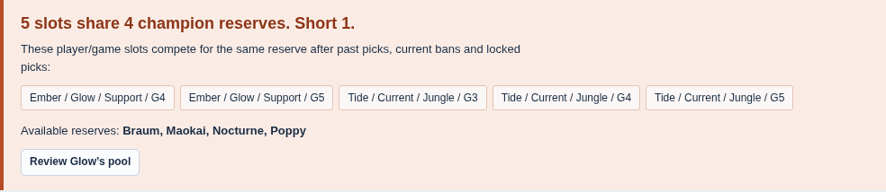

# Protect a shared reserve before the opponent replies

This fictional drill reuses Reserve’s complete ten-player practice plan. The series is tied 1–1 before Game 3, global Hard Fearless continues through Game 5, and Ember is assumed to pick first. Glow’s remaining support pool is **Rell, Alistar, Braum**. Tide can also select Rell.

Use the [complete two-pick walkthrough](#check-the-complete-immediate-two-pick-turn) below in the free browser workspace. The coach walkthrough runs entirely in the browser.

Both Ember first picks initially allocate **30/30**. Their worst Ember capacity over every available Tide first reply in the declared pools differs:

| Ember first pick | Before reply: joint | After reply: worst Ember capacity |
| --- | ---: | ---: |
| Rell | 30/30 | 15/15 |
| Alistar | 30/30 | 14/15 |

Representative replies:

| Ember locks first | Tide’s first reply | Joint capacity | Glow’s future reserve |
| --- | --- | ---: | --- |
| Rell | Thresh | 30/30 | Alistar + Braum for Games 4–5 |
| Alistar | Rell | 29/30 | Braum for two Games 4–5 slots; shortage 1 |
| Alistar | Thresh | 30/30 | Rell + Braum for Games 4–5 |


Locking Rell also removes Rell from Tide’s available replies. The script enumerates every currently available Tide player/champion binding for these two Ember picks; each reply is an unweighted possibility.

## Optional reproducible study

From a clone of [Reserve](https://github.com/blucca/series-reserve):

```sh
node docs/first-reply.mjs
```

The script reads only the bundled fictional `demo.json` and existing `lib/engine.js`. Its checks cover the original control, both first picks, all available first replies, complete two-pick turns and the two fictional pool additions below. Its output separates joint capacity and Ember’s independent team bound.

## Coach walk-through in the existing workspace

1. Open [the workspace](https://blucca.github.io/series-reserve/) and its fictional example (`demo.json`). Start with no locked current picks. Assume Ember picks first.
2. On **Reserve board**, expand **Game 3 actual draft**. Set **Glow / Support** to **Rell**, keep the other players **Not locked**, and click **Save current draft**.
3. Select **Tide takes Thresh**. Capacity stays **30/30**; Glow has Alistar and Braum for Games 4–5. Rell is already reserved, so **Tide takes Rell** is a conflicting comparison.
4. Click **Undo** to restore the unlocked preparation.
5. In **Game 3 actual draft**, set **Glow / Support** to **Alistar** and click **Save current draft**.
6. Select **Tide takes Rell**. Inspect the Hall certificate: **Glow / Game 4 and Game 5**, **Braum**, **shortage 1**. The current Alistar slot is already filled; the shortage concerns Glow’s future turns. Switching to **Tide takes Thresh** restores **30/30**. **Save JSON** and **Export handoff** while retaining the preparation you want to discuss; both comparisons are included.
7. After saving, click **Undo** to restore the unlocked preparation. Opening the saved JSON starts on **Base preparation**; select the saved comparison to inspect its reply.

The output is champion capacity under explicit pools and fixed player bindings, through the opponent’s **first single-pick reply**. Coaches supply tactical priorities, plausible replies and revised playable pools. Attribute each shortage to its affected team: pressure on the opponent and damage to our reserve have different decision value.

## Check the complete immediate two-pick turn

Using the same fictional pools and fixed bindings, Tide’s complete consecutive two-pick turn preserves the first-reply distinction:

| Ember first | Before reply: joint | Worst Ember after one reply | Worst Ember after two picks | Worst joint after two picks |
| --- | ---: | ---: | ---: | ---: |
| Rell | 30/30 | 15/15 | 15/15 | 30/30 |
| Alistar | 30/30 | 14/15 | 14/15 | 29/30 |

The pair uses different players and champions, with no intervening action. Picks already consumed, current bans and Ember’s first champion leave both reply pools. Counts are unweighted possible states.

### Three locks in the current workspace

[Download the two ready-to-open fictional plans](https://blucca.github.io/series-reserve/demo.html#reply-drill). **Open JSON** shows their saved actual drafts on **Base preparation**: Alistar-first **29/30**, Rell-first **30/30**. Their pools, rules, evidence and explanatory notes travel with the file.

To build either position yourself, start from the original fictional example with no current locks. Assume Ember first, followed by Tide’s two-pick turn.

1. On **Reserve board**, expand **Game 3 actual draft**.
2. Set **Ember / Glow / Support = Alistar**, **Tide / Reef / Top = Renekton**, and **Tide / Spray / Support = Rell**. Leave the other players **Not locked**, then **Save current draft** and select **Base preparation**.
3. Inspect **29/30** and the Hall certificate: **Glow, Game 4 and Game 5; Braum; shortage 1**. All three current picks are filled; Glow’s future reserve is damaged. **Save JSON** and **Export handoff now, before Undo**, to keep these three locks and the future shortage for a teammate.
4. Click **Undo** to restore the unlocked preparation.
5. For the protected example, set **Glow = Rell**, **Reef = Renekton**, **Tide / Current / Jungle = Nocturne**, then **Save current draft** and select **Base preparation**. Capacity is **30/30**. Save and export this protected position before **Undo**. Opening either saved JSON starts on **Base preparation**, so the recorded three locks and their capacity appear immediately; the other pick comparisons remain available.

The first-reply result retains its original scope. This extension covers the complete immediate turn under the same pools and bindings. Coaches supply tactical priorities, flex assignments and any later-turn or future-ban scenario.

## Why test a reply?

In a [five-region coaching interview](https://dotesports.com/league-of-legends/news/coaches-from-five-regions-explain-how-fearless-draft-transformed-lol-esports), Goldenglue described teams prioritizing the opponent’s best picks; Rodrigo described preparation around combinations and answers. The article was published on 16 March 2026 from interviews at Worlds 2025. This drill tests one concrete reserve interaction.

A complete allocation is a jointly available arrangement. The next reply can consume a champion used by that arrangement. Here, taking the shared champion first protects Ember’s declared reserve through the first reply and the complete immediate two-pick turn. Later turns, future bans, flex assignments and matchup quality form the coach’s next preparation state.

## Which extra repairs this immediate turn?

To keep **Glow’s Alistar first**, compare extras assumed approved for Glow. This fictional study assumes either **Thresh** or **Poppy** is stage-ready for Glow; the other demo pools and global Hard Fearless rule stay unchanged. Each condition has **16 Tide single bindings** and **102 legal complete immediate consecutive two-pick states**.

| Extra in Glow’s pool | After Tide Rell: Ember / joint | Two-pick states with Ember shortage | Worst two-pick Ember / joint |
| --- | --- | ---: | --- |
| Original pool | 14/15 · 29/30 | 12/102 | 14/15 · 29/30 |
| + Thresh | 15/15 · 30/30 | 0/102 | 15/15 · 30/30 |
| + Poppy | 15/15 · 29/30 | 1/102 | 14/15 · 29/30 |

**Thresh repairs all 102 states** within this turn. Tide’s fixed support binding makes Rell and Thresh alternative replies. **Poppy reduces damaging states from 12 to 1**: Tide support Rell plus Tide jungle Poppy consumes both shared options. Another 11 states retain Ember 15/15 while joint capacity remains 29/30. Counts are unweighted possible binding states.

The workspace displays **joint capacity**. Ember’s bound comes from the study, relaxing Tide’s free future demands. With Poppy added, the single Rell reply leaves five slots—Glow G4–G5 and Tide jungle G3–G5—sharing four reserves: **Braum, Poppy, Nocturne, Maokai**. That mixed Hall certificate explains the joint shortage despite Ember’s 15/15 bound.



### Inspect either addition

1. In **Evidence & pools**, add one candidate to Glow’s unchanged pool and confirm it for this fictional exercise.
2. In **Game 3 actual draft**, set **Glow = Alistar**, **Spray = Rell**, **Current = Poppy**; leave others **Not locked**. **Save current draft → Base preparation**: Thresh gives 30/30; Poppy gives 29/30, with Glow G4–G5 sharing Braum.
3. In the Poppy condition, set Current to **Not locked** and save again to inspect the single-reply five-slot/four-reserve certificate. **Save JSON** and **Export handoff**.

Choose among approved extras using this immediate-turn capacity comparison. Update the preparation for the next game, later actions and future bans; these results cover fixed declared pools and this immediate consecutive two-pick turn.
